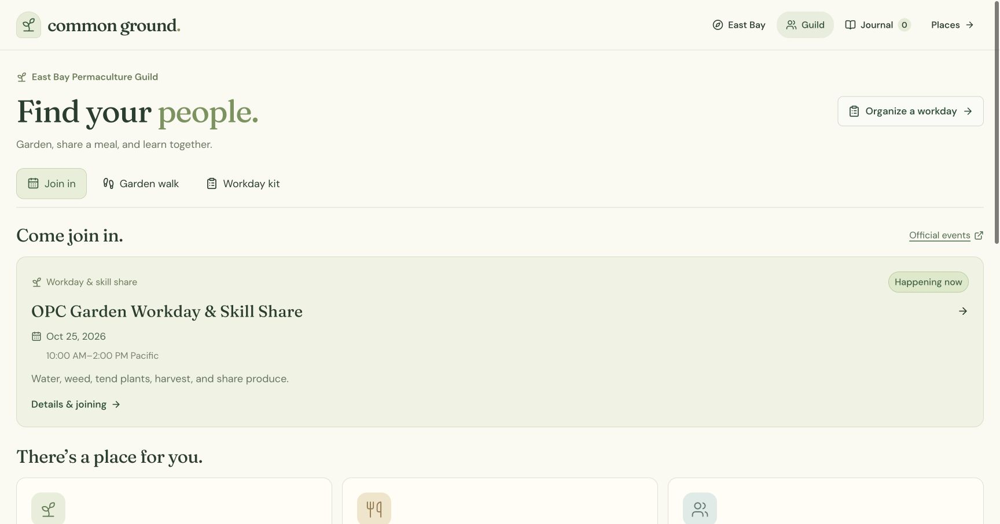

# Common Ground hub (branch `permaculture-hub`)

One Bay Area permaculture hub with three sections that share a header, fonts, and palette (`public/hub/hub.css`, `public/hub/hub.js`):

| Section | URL | What it is |
| --- | --- | --- |
| Home | `/` | Coast-to-interior climate cross-section, doors into each section, a month-by-month task guide |
| Explore | `/learn` | The Common Ground map, now with places across the nine counties, climate layers (summer heat, rain, frost), field stamps, and planting checks that use the nearest regional climate reference |
| Plan | `/plan/` | PermaPlot (static). Accepts `?lat=&lon=&place=#check` from Explore |
| Canopy | `/canopy/` | The guild volunteer CRM. **Admin only**: `/login`, then you land on the dashboard |

```sh
npm ci        # or reuse an existing node_modules
npm run dev   # http://127.0.0.1:5180
```

**Volunteers (East Bay Permaculture Guild).** The hub's main goal is to bring people into the Guild. `/volunteer` (the Volunteer tab) pitches volunteering and shows the Permaculture Seed Kit; its quick start opens `/join` pre-filled. Signed-in volunteers get a dashboard: Seeds wallet and tier (Canopy's own earn rules), a tracker with monthly goals and logged hours, RSVPs, the Guild's channels, a referral link, a neighborhood challenge, badges, and a seed shop. Organizers manage it in Canopy → **Hub sign-ups**: check people in (awards Seeds), confirm logged hours (2 Seeds/hour), publish events, and pack shop rewards. Locally the data is SQLite in `.local-data/volunteers.sqlite`. On Vercel it needs Upstash Redis: in the Vercel project, Storage → connect Upstash (sets `KV_REST_API_URL`/`KV_REST_API_TOKEN`); until then `/join` explains sign-ups aren't switched on.

Admin sign-in defaults to `admin` / `permaculture` (shown on the sign-in page while defaults are in use). Set `HUB_ADMIN_USER`, `HUB_ADMIN_PASSWORD`, and optionally `HUB_SESSION_SECRET` to change it. The gate is one account with a signed HttpOnly cookie and a failed-attempt limit, suitable for a demo, not a multi-user identity system. Canopy's send and AI endpoints are served under the gate at `/canopy/api/*`; put `OPENROUTER_API_KEY` (or Gemini/OpenAI keys) and Resend/Twilio keys in `.env` to enable them, otherwise sending is a dry run.

Hosting on Vercel: `vercel.json` builds with Vite into `dist/` and rewrites `/learn` and `/login` to the app. `middleware.js` runs the admin sign-in and the Canopy gate at the edge. Set `HUB_ADMIN_PASSWORD` and `HUB_SESSION_SECRET` in the Vercel project's environment variables, or the demo login applies. The hosted site is static: garden-project sharing (local SQLite) and Canopy's send/AI endpoints only work under `npm run dev`; Canopy falls back to mailto/sms links.

Regional climate: `node scripts/prepare-bay-area-climate.mjs` builds `src/data/bay-area-climate.json` from Open-Meteo (ERA5-Land temperature, ERA5 rain, 2021–2025) for 30 reference points and an interpolated land grid. Rain comes from a ~25 km grid, so it is coarse; the map labels the layers as blended between reference points.

---

# Common Ground

**Explore your neighborhood. Learn how land works. Grow something together.**

Common Ground is a playable cartoon map that starts in the East Bay and zooms out across the Bay Area, connecting environmental learning with real community places, Guild activities, and garden projects. Visit a farm, park, garden, or library; experiment with soil, water, plants, and shared resources; then find a Guild gathering or check a planting spot and invite neighbors to help.

Built for Hack for Social Impact 2026, combining the East Bay Permaculture Guild’s regeneration-map challenge with UNCCD’s youth land-use education challenge.


**Current scope:** a working local prototype with four illustrated learning destinations, ten discoveries, six starter plants, sixteen directory entries, and an **Oakland Peace Center** participation destination. The **Guild** view adds three source-checked October event records, three program types, an illustrated preparation walk, and a reusable workday kit. The starting view remains **West Oakland, Lake Merritt, and Ivy Hill**. Zoom out to a generalized **Bay Area** map covering the nine-county region and some neighboring context; planting checks and garden proposals work across this wider window. Detailed site geometry and environmental data remain in the Oakland pilot.

## Why this project

Someone interested in regeneration may not know where to go, what they can contribute, or why a garden’s soil, water, and continuing care matter. Organizers also need a manageable way to welcome volunteers and keep participation information current.

Common Ground demonstrates one connected journey:

**Explore a place → learn something useful → find a Guild activity → prepare → RSVP through the host → find the next gathering.**

The resident-led route remains available: **check a growing spot → propose a garden → join a team**. Official Guild events and resident proposals have separate records and participation flows.

The primary audience is curious residents and young people, including the **15–24** audience in the UNCCD brief. Organizers and returning volunteers are the secondary audience. Learning is tied to familiar local places, with short instructions, large type, original illustrations, and optional deeper explanations.

### How it addresses the hackathon briefs

The supplied [East Bay challenge](https://hackforsocialimpact.notion.site/East-Bay-Regeneration-Map-4022cb772f1e80dabe47cd94b010654e) is currently titled **Growing Participation in East Bay Permaculture**. Its [mapping product brief](https://docs.google.com/document/d/1m9Oc5qZ_Gla9vVhpRFqsx2wpiXLr2jGbMJTLzlc1s48/edit?tab=t.45jzotseqcp8) describes discovery, participation, trusted updates, and community control.

| Need in the brief | What Common Ground demonstrates | Remaining work |
| --- | --- | --- |
| Help residents understand permaculture’s relevance | Clickable learning scenes connect soil, water, shade, food, habitat, and shared resources to neighborhood choices. | Youth and knowledgeable steward review; test whether the lessons improve understanding. |
| Make nearby opportunities easy to discover and join | An illustrated map, source-checked directory, Peace Center destination, Guild program/event cards, and official Partiful links. | Broader coverage and steward confirmation of current participation arrangements. |
| Help volunteers prepare and keep returning | Three property-walk questions, newcomer/returning preparation, existing volunteer-interest form, next-event links, and calendar downloads for confirmed current/future events. | Knowledgeable review, facilitated use, and evaluation of actual return participation. |
| Reduce repeated organizer work | A SOP-based workday kit with editable roles and agenda, saved drafts, duplication, print/Markdown/CSV exports, and invitation/reminder/follow-up copy. | Host review and measured comparison with the existing workflow; shared roster/attendance and approved outreach integrations. |
| Keep community knowledge current and reviewable | A local correction/review demo, structured seed records, readable resource pages, JSON exports, and a documented discovery workflow. | Shared review, steward-managed listings, inactive-listing handling, and nontechnical editing. |
| Retain control and enable replication | Source, curated records, attributed geographic data, and setup instructions live together in this repository. | Agree ownership, a release license, and a Guild publishing process; adapt the geography and content for another region. |

The complementary [UNCCD challenge](https://hackforsocialimpact.notion.site/Engaging-Youth-in-Sustainable-Land-Use-Decisions-4002cb772f1e80649effe9041c2957bd) asks players to make meaningful land-use choices, understand consequences over time, compare alternatives under resource constraints, and apply learning locally. Common Ground uses matched experiments, delayed tree growth, written reflections, and a downloadable field journal. Its purpose is education, participation, and public benefit; there are no purchases or paid gameplay.

This is an independent prototype built for the **East Bay Permaculture Guild challenge**. Adoption, endorsement, and access to private tools or data have not been agreed.

### Existing tools: what we reuse and add

The Guild's existing public tools were reviewed on **October 25, 2026**. This assessment covers public pages and documents, not administrator workflows or backend access.

| Existing tool | Verified public behavior | Common Ground's relationship |
| --- | --- | --- |
| [Collective Resilience Lovable MVP](https://strength-weave-net.lovable.app/community-resources) | Leaflet resource map, organization filters, and a submission form that describes review before publication. | Adds interactive local learning, explicit sources/access, and participation routes. No data import, synchronization, or replacement is claimed. |
| [Lovable Guild page](https://strength-weave-net.lovable.app/east-bay-permaculture-guild) | Guild information, Partiful, and volunteer-form links. Its “next meeting” still points to July 13, 2026. | Reuses official links and calculates dated event status; does not repeat the stale invitation. |
| [Partiful](https://partiful.com/u/PcnFYcpQOwCLdVFxzZ3i) and the [volunteer-interest form](https://docs.google.com/forms/d/e/1FAIpQLScWYNUTGP3sdrGopwEcImSZ--WlXjbktrZH6KJ5ptlR3p3xLQ/viewform?usp=publish-editor) | Public dated events and existing volunteer intake. | Official RSVPs and ongoing interests remain in those tools. No duplicate Guild signup, private guest list, or form-response import. |
| [Workday SOP and agendas](https://docs.google.com/document/d/1T-lPrgM3dPlboTDOcU-ODvnFgtNQyguP5td1CtvXHOg/edit?usp=sharing) | Setup, welcome, introductions, garden tasks, meal, reflection, and operational responsibilities. | Adapted into an editable preparation and organizer template; role targets need host review. |
| [OPC property walk](https://docs.google.com/document/d/1KzH6SQ_T65FXoSWJB_hPVGtevyWb3qqSL6NuPx5NzPQ/edit?usp=drivesdk) | Observation prompts about sun, water, shade, site history, and planting. | Three short illustrated observations connect learning to participation. The illustration is not a surveyed OPC layout. |

See the [tool review and reuse decisions](docs/guild-tool-review.md) for sources, workflow mapping, and unverified access. No forms were submitted or events RSVP'd during the review.

## Features

### A real neighborhood, illustrated

- One continuous map based on OpenStreetMap streets, buildings, parks, and Lake Merritt, with original SVG artwork.
- A lightweight Bay Area overview with real coastline, major roads, urban areas, and city labels. Use **−** to zoom out or the **globe** to fit the region; the **frame** button restores the original Oakland view.
- Four visitable places: **West Oakland Farm Park**, **deFremery Park**, **Gravity Garden**, and **West Oakland Library**.
- **Oakland Peace Center** opens Guild activities directly from its public map location; game completion is optional.
- Pan, zoom, whole-map reset, keyboard controls, reduced motion, and readable desktop and phone layouts.
- An animated character travels along precomputed street routes between destinations.


### Learn by interacting

- Follow the compost journey and compare where the same rain goes in different demonstration beds.
- Try growing choices with limited water, credits, and care; save approach A and compare it with B under the same conditions.
- Explore tree growth today versus five years later, moving shade, and competing uses of shared space.
- At Gravity Garden, compare planting mixes and distribute a fictional harvest among different community needs.
- Collect **ten discoveries**, reflect at the library, and download a Markdown field journal. Progress and one previous trip are saved in the browser.

### Check a planting spot

Click an empty map spot, or use **Check a spot** on an existing destination. The app combines mapped context and approximate terrain with six observations: **sun, water, drainage, growing area, soil review, and season**.

Compare tomatoes, lettuce, kale, California poppy, California fuchsia, and California buckwheat. Each gets a preliminary **Check first**, **Needs a change**, or **Promising** result, with reasons, care information, and primary sources. Unknown observations stay unknown. Selected plants carry into a garden proposal.

Outside the Oakland pilot, the map offers general regional context. Site details, elevation, slope, and local climate remain **Unknown** until suitable data is added; the app does not apply Oakland’s climate reference to the rest of the Bay Area. Plant matches still use your observations and need local variety/site review.


### Start a garden and find a team

Choose any map point to propose a **new garden**, **garden revival**, or **landscape project**. The two-step form captures:

- Name, goal, plants, and an organizer nickname.
- USD budget target, additional volunteers needed, and requested roles.
- Permission status and a continuing-care plan.
- Optional work date, budget breakdown, and meetup notes.

Projects appear as map pins and on a board with **All**, **Needs help**, and **My projects** views. Other visitors can join, choose a role, update availability, or leave. Organizers can edit the plan and close or reopen signups. SQLite transactions protect volunteer capacity during simultaneous joins.


The screenshot is a fictional playtest proposal. Budgets are planning targets; the app collects no money. Pending permission is marked **Planning only**. An organizer’s permission report is not independently verified.

### Find real next steps

The wider **Places** directory contains **16 source-checked entries**: 15 public map locations and one online guide. Listings include an original summary, access information, provider participation link, source publisher, and check date. Generated HTML pages work independently of React and expose machine-readable JSON for reuse.

### Join a Guild gathering

Open **Guild** or the Peace Center map destination to explore garden workdays, potlucks/community evenings, and garden planning.

- Three verified October 2026 event records include hosts, published venue details, preparation, source dates, and canonical event links.
- Date handling distinguishes upcoming, happening now, past, cancelled, and unconfirmed records. Past events lead to **Find the next gathering**; recurring patterns never generate invented future dates.
- Partiful handles the official RSVP. Calendar downloads are one-time copies, available only for confirmed current/future dates.
- The **Garden walk** has clickable water, shade, and soil objects with three observation questions adapted from the existing property walk.
- **First visit / Returning** preparation and next-event/volunteer-form links are accessible without completing a lesson.

The October 15 planning event does not publish a precise venue to anonymous visitors, so it has no map pin. Preparation answers stay in the browser; they do not establish competence, attendance, or consent for messages.



### Organize from a reusable workday kit

Open **Guild → Workday kit** to adapt the public SOP into a draft:

1. Edit the name, date, public arrival note, tasks, supplies, and optional official RSVP link.
2. Adjust seven suggested responsibilities and helper targets; optionally add draft lead nicknames.
3. Review and edit the eight-step agenda, export Markdown or a role-plan CSV, or print the kit.
4. Copy invitation, reminder, and follow-up drafts into the host's agreed channels.
5. **Reuse for another day** keeps the edited plan while clearing the date, RSVP link, and lead assignments.

Up to twelve drafts are saved locally in this browser. Counts are planning targets; exports are not attendee rosters. The kit does not publish events, send messages, synchronize registrations, or create attendance history. The source contains several agendas rather than one fixed official role taxonomy. Host/content review is pending.

## Set up locally

**Requirements:** Node.js **24 or newer**, npm, and Git. Node’s built-in SQLite powers the project API. No containers, API keys, or separate database installation are needed.

```sh
git clone https://github.com/KuanL1u/common-ground.git
cd common-ground
npm ci
npm run dev
```

Open **http://127.0.0.1:5173/**.

The server binds to this computer. The included map and environmental datasets are ready to use; normal setup does not refresh them from external APIs. `npm ci` requires internet access to install dependencies. The optional directory map uses OpenStreetMap tiles.

| Command | Purpose |
| --- | --- |
| `npm run dev` | Generate resource pages/data and start the local game and community API on port 5173. |
| `npm test` | Run the automated model, persistence, geography, directory, and community checks. |
| `npm run build` | Generate resource pages/data, check TypeScript, and build into `dist/`. |
| `npm run preview` | Serve the built game and local community API on port 4173. Run the build first. |

If a configured port is occupied, stop the previous instance or choose another port, for example `npm run dev -- --port 5174`.

### A useful demo route

1. Visit **Farm Park** and change a soil condition before running the rain experiment.
2. Save two growing approaches and compare them during the same dry period.
3. Visit **deFremery Park**, advance tree growth, and try a different shared-space choice.
4. Visit **Gravity Garden** to compare planting mixes or harvest-sharing choices.
5. Open **Check a spot**, answer the site questions, and select plants.
6. Choose **Start a garden** and publish a clearly labeled demo proposal.
7. Open its project link in a separate browser profile or private window to join as another visitor. Return to the organizer view to see the team.
8. Visit the library or **Journal** to reflect and download your notes; open **Places** for provider participation information.
9. Click the **Peace Center** or **Guild**. Check the date/status and open the host's official participation link.
10. Try the three **Garden walk** observations. Build a **Workday kit**, edit a role, export it, and duplicate it for another draft.

Separate browser profiles have separate anonymous identities. Use the same origin and profile for organizer work.

## Architecture and saved data

The interface uses **React, TypeScript, and Vite**. The cartoon world and activity artwork are SVG; the wider directory uses Leaflet. Lessons and plant screening use deterministic rules. There is no AI service required at runtime.

| Layer | Implementation | Persistence |
| --- | --- | --- |
| Exploration and journal | `src/exploration/` | Validated browser storage, with a previous-trip backup and Markdown export. |
| Guild activities and preparation | `src/guild/data.ts` and `src/guild/` | Public records in Git; preparation choices and workday drafts in validated browser storage. |
| Map and camera | Local Oakland geometry plus `src/data/bay-area-map.json` | Saved vector layers fetched separately; no runtime map API for the cartoon world. |
| Planting checks | `src/community/` plus `src/data/site-environment.json` | Saved environmental baseline; visitor answers can accompany a proposal. |
| Garden projects and teams | `/api/community`, mounted by Vite in dev and preview | Local SQLite at `.local-data/gardens.sqlite`. |
| Curated directory | `src/data/resources.ts` | Git-managed seed data; correction/review demo changes stay in that browser. |
| Readable listings and exports | `scripts/generate-resource-pages.mjs` | Generated into `public/projects/`, `public/activities/`, and `public/data/`, then included in the build. |

An HttpOnly cookie retains anonymous organizer/member controls across server restarts. Clearing that cookie loses the identity; there is no account recovery yet. Development and preview use different identity cookies and share the default database.

For an isolated playtest, choose another data directory:

```sh
COMMON_GROUND_DATA_DIR=/tmp/common-ground-playtest npm run dev
```

To back up projects, stop the server and copy `.local-data/`. The database, credentials, dependency folders, raw downloaded data, and build outputs are excluded from Git. Journal data and workday drafts remain in their browser unless exported. Public activity JSON contains only curated sources; local drafts and project data are never generator inputs.

### Project layout

```text
src/
  exploration/       Cartoon world, scenes, experiments, journal
  community/         Plant screening, project forms, board, SQLite API
  guild/             Public activities, preparation walk, reusable workday kit
  data/              Curated resources, map geometry, environmental baseline
  components/        Directory, review desk, shared interface components
  lib/               Validation, storage, directory logic, automated tests
scripts/             Resource-page generation and optional data refreshes
docs/                Provenance, evaluation, discovery, and playtest records
artifacts/           Demonstration screenshots and sample playtest journals
public/favicon.svg   Original application icon
```

Earlier parcel-grid prototype modules remain in the source for reference; the current playable interface starts with the cartoon map.

## Evidence and limitations

| Information | Where it comes from | How to interpret it |
| --- | --- | --- |
| Place listings | Public provider websites, checked October 24–25, 2026 | Source checks do not establish partnership, current availability, youth eligibility, or permission to enter. |
| Map geography | Attributed OpenStreetMap extracts and a Natural Earth regional overview | Oakland has detailed geometry; the wider overview is generalized at 1:10 million scale, with OSM city labels. Neither is surveyed site evidence or navigation instructions. |
| Climate | One Oakland ERA5 reference for 2016–2025, approximately 25 km resolution | Historical modeled context, not parcel weather, a hardiness-zone lookup, or official 30-year normals. Unknown outside the pilot. |
| Terrain | 504 samples derived from Copernicus DEM GLO-90 | Approximate elevation and area slope; small beds, walls, and drains are unresolved. |
| Plant suitability | Visitor observations and simplified rules informed by UC ANR and Calscape | A preliminary shortlist; sun, soil chemistry, contamination, ownership, and utilities are not measured. |
| Learning outcomes | Authored game rules with explanatory sources from UNCCD, EBMUD, EPA, and USDA NRCS | Tokens and 0–100 indicators teach relationships and tradeoffs; their coefficients are not scientifically calibrated predictions. |
| Guild events and templates | Public Partiful records, workday SOP/agendas, and OPC property walk, checked October 25, 2026 | Dated source records and editable adaptations; no private data access, official staffing, host approval, or content-review completion is implied. |

The game’s experiments and library learning desk are fictional teaching scenes. They do not describe approved changes or programs at the real destinations. Sources and assumptions are available inside the app and in the documentation below.

## Hosting and path to a community pilot

The mapping brief prefers **GitHub-managed data and Netlify hosting**. This repository provides the source and curated data; the generated frontend can be hosted statically. **Serving `dist/` alone does not provide garden publishing or volunteer signups.** Those features currently use the local Node/SQLite API, which accepts local hosts and same-origin writes.

An online pilot needs a hosted API/database, recoverable identities, shared moderation, and an agreed process for steward permission and public listing updates. Project links currently work on the local server. The new Guild discovery/preparation/kit views can run on static hosting, but their saved drafts are still device-local. Partiful and the existing volunteer form remain the external participation tools.

A proposed **8–10 week follow-on**, subject to partner review:

1. **Weeks 1–2:** review lessons and workday adaptations with youth and stewards; confirm private-tool/data reuse access following the completed public audit; agree ownership, reviewer responsibilities, and the pilot journey.
2. **Weeks 3–6:** deploy the frontend and community service; add recoverable accounts, shared listing review, and permission/moderation workflows.
3. **Weeks 7–10:** run a small facilitated pilot, revise confusing interactions, test volunteer handover, and document how another community adapts the content.

This is a planning estimate, not an agreed delivery commitment. Local use has no paid API dependency. Online operation adds hosting, database, and potentially domain costs, alongside ongoing source checks, moderation, backups, and plant-content review.

## Validation and educational evaluation

The current implementation has **51 automated tests**, including Guild date boundaries, calendar timezone/escaping, draft reuse/persistence, export contents, and venue privacy. TypeScript and the production build are checked alongside browser playtests. See the [playtest report](docs/playtest-report.md) for the actual results and covered journeys.

Software checks do not establish educational effectiveness. A [content-review pack](docs/content-review-pack.md) is ready for a knowledgeable reviewer; **review has not happened yet**. The [evaluation plan](docs/evaluation-plan.md) proposes a facilitated session with 5–8 participants, before/after reasoning prompts, and an organizer workflow comparison. Learning gains, time saved, and real participation remain to be evaluated. Gameplay monitoring is outside the UNCCD brief’s scope.

## Contributing and handover

- **Add or correct a resource:** follow the [discovery and review workflow](docs/resource-discovery.md), then edit `src/data/resources.ts`. Use public or consented information, primary sources, explicit access details, and the date of an actual source check.
- **Change a lesson or plant rule:** update the relevant content/model files, document assumptions, seek knowledgeable review, and run the tests and build.
- **Refresh geographic data:** follow [map provenance](docs/map-provenance.md). Python 3 is needed only for optional map regeneration.
- **Refresh environmental data:** follow [planting and project implementation](docs/planting-and-projects.md). Normal setup uses the committed baseline.
- **Update Guild activities:** edit `src/guild/data.ts` with checked public event information, timezone-aware start/end instants, a canonical participation link, and a check date. Do not infer future dates from recurrence, expose gated venues, or mix workday drafts with public events. Rebuild the readable pages and public JSON.
- **Expand within the Bay Area:** add reviewed local geometry, environmental coverage, places, and learning activities to the regional map. Keep unavailable measurements unknown. Geography, content, and rules are separated, but new destinations still need source checks and review.
- **Adapt another region:** replace the overview/coverage bounds and local map/anchors, then curate local places, environmental baselines, and activities.

Local directory approval does not publish to GitHub or update generated pages. Curated changes need repository review and a rebuild. The [manual discovery prompt](docs/resource-discovery.md) supports finding candidates for human review; no scheduled crawler is implemented.

## Documentation and attribution

- [Map geography, routes, sources, and regeneration](docs/map-provenance.md)
- [Planting rules, environmental data, project workflow, and storage](docs/planting-and-projects.md)
- [Resource discovery and review](docs/resource-discovery.md)
- [Guild tool review, reuse decisions, and SOP mapping](docs/guild-tool-review.md)
- [Approved Guild participation implementation proposal](docs/guild-participation-improvements.md)
- [Content-review pack — review pending](docs/content-review-pack.md)
- [Proposed educational evaluation](docs/evaluation-plan.md)
- [Implementation playtests](docs/playtest-report.md)

Map data: **© OpenStreetMap contributors**, distributed under [ODbL 1.0](https://www.openstreetmap.org/copyright). Regional land, water, roads, and urban-area geometry: [Natural Earth](https://www.naturalearthdata.com/), [public domain](https://www.naturalearthdata.com/about/terms-of-use/). City labels retain OSM attribution. Climate and elevation credits, source requests, dates, and resolutions are retained in the data and provenance documentation. Illustrations are original SVG artwork; dependencies retain their upstream licenses.

The repository is public. No project-wide source-code license has been selected yet.
